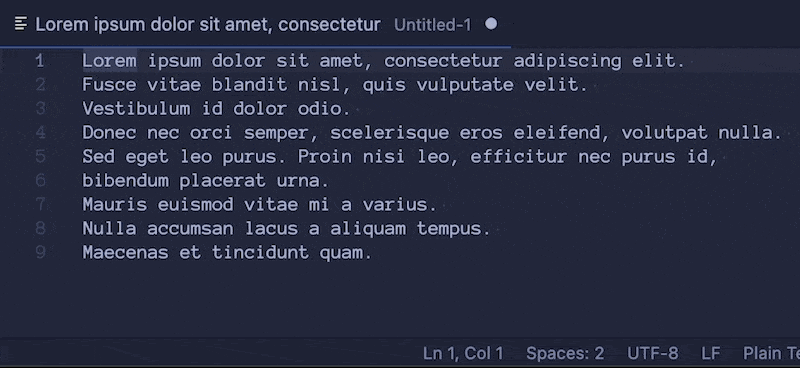
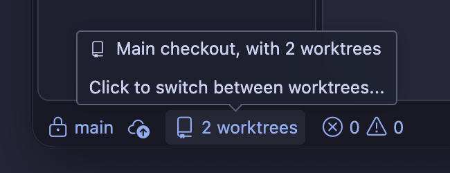
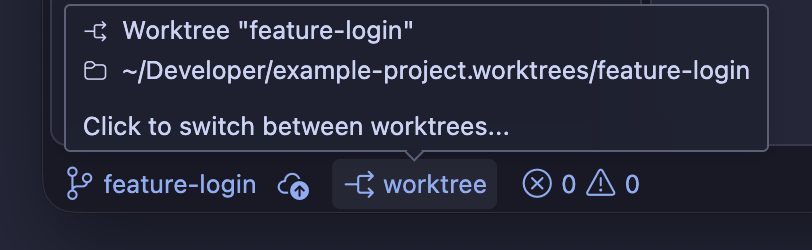

# StatusBar+

StatusBar+ is a small extension which adds a couple of useful items to your VS Code statusbar.

1. A proper line and column counter.

2. Worktree indicators.

## Line and column counter

Unlike the built-in "Editor Selection" which only shows the character count, StatusBar+ supports multiple cursors, with multiple selections, giving you accurate counts across them all.

After installing StatusBar+, hide the built-in one by right-clicking in the status bar and deselecting `Editor Selection`.



## Worktree indicators

Git worktrees are a useful way to juggle multiple streams of work, by creating additional local copies of a repository, each pointing at a different branch, but the way VS Code handles these isn't great out of the box.

StatusBar+ adds indicators next to the Git branch name, which clearly show you:

1. If you're in the main checkout.

2. Whether any worktrees are available.

3. Or that you're currently inside a worktree, along with the path on disk.

You can also click on the indicator to see a list of the available worktrees (including the main checkout) and quickly switch between them all (opening in a new window).





## Release Notes

### 1.3.0

Updated to the latest versions of the VS Code extension dependencies, fixing several NPM vulnerabilities.

### 1.2.0

Updated the extension to use the latest version of the VS Code API, and resolve a number of NPM vulnerabilities.

### 1.1.0

Added a count of the number of characters in the current selection.

### 1.0.0

Initial release.

## Local Development

1. Install NodeJS:

    ```
    brew install nodejs
    ```

2. Install the project dependencies:

    ```
    npm install package.json
    ```

3. Open this repository in VS Code and choose `Run -> Start Debugging` or press `F5`.
